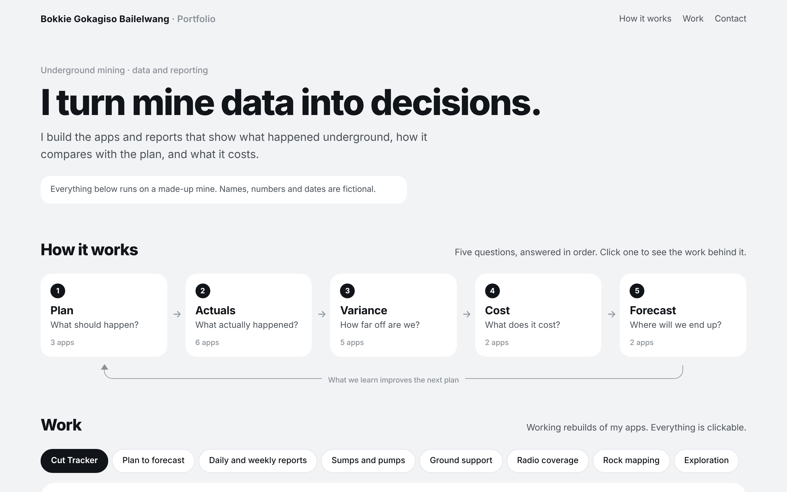
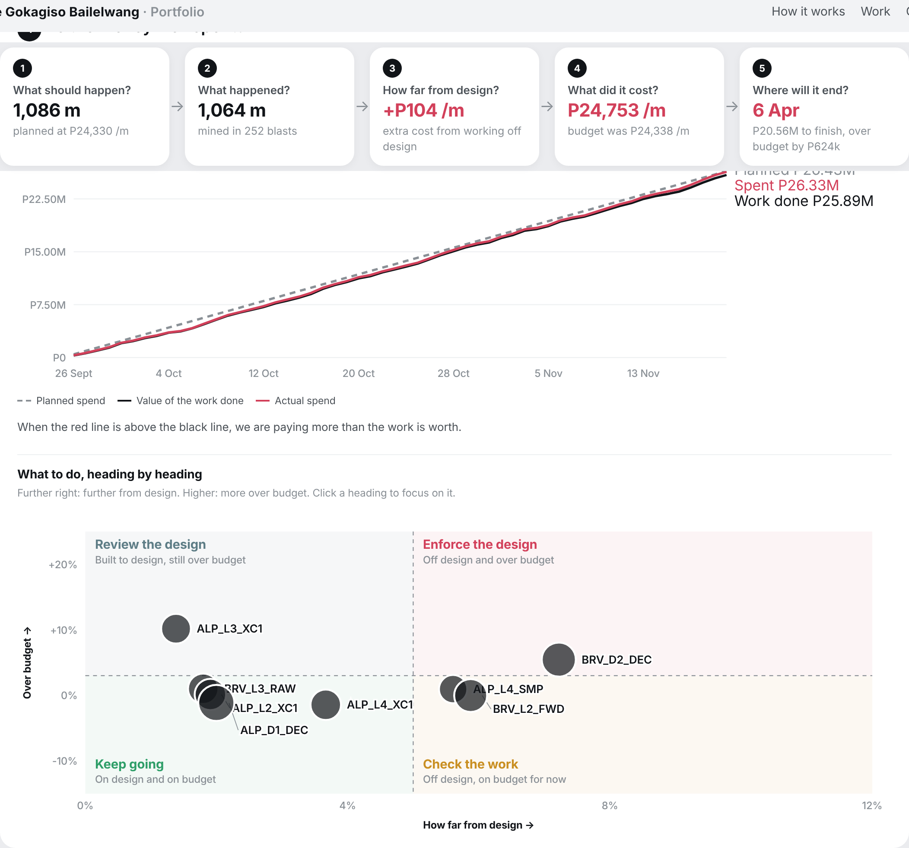

# Mine Intelligence Portfolio

**I turn mine data into decisions.**

Working rebuilds of the underground mining apps and reports I build, running on a made-up mine. Every app is clickable.



## How it works

The portfolio follows five questions, answered in order:

| Step | Question | What it means |
|---|---|---|
| 1. Plan | What should happen? | The mine plan and the engineering design: metres, blasts, quantities and budget |
| 2. Actuals | What actually happened? | Validated shift data for every blast |
| 3. Variance | How far off are we? | Actuals against the plan and design |
| 4. Cost | What does it cost? | Each gap turned into cost per metre and burn rate |
| 5. Forecast | Where will we end up? | Finish dates and cost to complete at today's pace |

What we learn feeds back into the next plan.

## The apps

| App | What it does |
|---|---|
| Cut Tracker | Follows every blast from drilling to survey, and compares the week with the plan |
| Plan to forecast | All five steps in one app, with the working shown for every variance |
| Daily and weekly reports | The daily and weekly reports, built automatically from shift records |
| Sumps and pumps | Shows which sumps need cleaning and which pumps are due for a washout |
| Ground support | Checks the bolts and shotcrete installed against the design |
| Radio coverage | Maps underground radio signal and lists the dead zones to fix |
| Rock mapping | Ties rock mapping to the tunnel position and the support each rock type needs |
| Exploration | A personal demo for drilling programmes: spend, forecast and lab sample tracking |



## About the data

All data is fictional and generated in the browser. Heading names, people, equipment, dates and figures are invented. The layouts reflect production work; the numbers do not.

## Run it

No build step and no dependencies. Open `index.html` in any browser, online or offline.

## Publish on GitHub Pages

1. Create a new public repository named `<your-username>.github.io`.
2. Upload every file in this folder, keeping `index.html` at the top level.
3. Go to **Settings → Pages**, choose **Deploy from a branch**, pick `main` and `/ (root)`, then **Save**.
4. After a minute or two the site is live at `https://<your-username>.github.io`.

## Project structure

```
index.html          the whole portfolio: page, styles, apps and fictional data in one file
assets/             screenshots used in this README
.nojekyll           tells GitHub Pages to serve the files as they are
LICENSE             all rights reserved
```

## Contact

Bokkie Gokagiso Bailelwang · Gaborone, Botswana
bokkiebailelwang@gmail.com

© 2026 Bokkie Gokagiso Bailelwang. All rights reserved.
